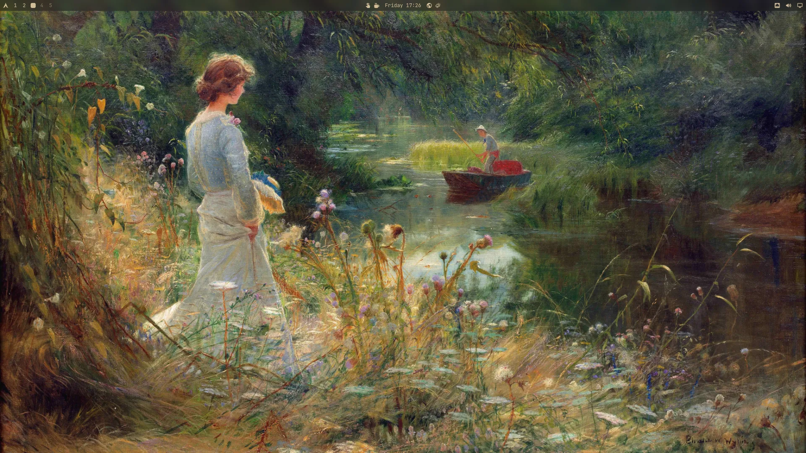

# quattro-hypr

Minimal [Hyprland](https://hypr.land/) desktop configuration and Quickshell environment for Arch Linux.



## Directory layout

- `config/` - user dotfiles (`hypr`, `quattro`, `foot`, `btop`, `tmux`, `git`, `imv`, `lazygit`, `satty`, `wireplumber`, `xdg-desktop-portal`, `starship.toml`, `hyprland-mimeapps.list`, `brave-origin-flags.conf`)
- `default/` - runtime defaults (bash startup & functions, Hyprland Lua modules & native C++ `titlebars` plugin, theme templates, `i18n` catalogs, input-method setup, systemd user units, uwsm env, SDDM theme, fonts)
- `bin/` - `quattro` CLI router and `quattro-*` helper executables
- `shell/` - single-process Quickshell desktop ([`shell/README.md`](shell/README.md): bar, dock, menu/launcher, panels, overlays, notifications, polkit, lockscreen)
- `themes/` - 10 curated color schemes (`Tokyo Night`, `Catppuccin`, `Catppuccin Latte`, `Everforest`, `Gruvbox`, `Kanagawa`, `Matte Black`, `Nord`, `Rose Pine`, `Solitude`)
- `applications/` - core `.desktop` entries and dynamic SVG icons
- `etc/` - system config files (`fastfetch`, `mpv`, `xkb`, `profile.d`, `sddm.conf.d`, `sudoers.d`, `systemd`, `tmpfiles.d`)
- `packages/` - core Arch package list ([`arch-core.packages`](packages/arch-core.packages))
- `install.sh` - single-command installer (deploys packages, runtime, configs, theme, and system integration)
- `uninstall.sh` - complete uninstaller (removes runtime, configs, themes, system integration, core packages, and CachyOS repos)
- `verify.sh` - checks script syntax, Lua compilation, JSON/JSONC/XML configs, CLI routes, hygiene, pacman package names, and sandbox install
- `AGENTS.md` - architecture, QML/CLI conventions, and performance guidelines for contributors

## Install

Check script syntax, Lua files, and package names without touching the system:

```bash
./verify.sh
```

Run the installer (installs core packages, runtime, user configs, initial `Tokyo Night` theme, and system integration):

```bash
./install.sh
```

Existing user files in `~/.config` and `~/.bashrc` are overwritten directly without creating backups.

## Starting the session

Log in via SDDM (choose **Quattro (Hyprland uwsm)**), or start it from a TTY:

```bash
uwsm start hyprland.desktop
```

## CLI usage

Inspect top-level command groups and talk to the running desktop shell via `quattro`:

```bash
quattro --help
quattro theme list
quattro theme set catppuccin
quattro bar position top
quattro dock autohide
quattro shell ping
```

## Uninstall

Remove Quattro completely (runtime, user configs, themes/icons/fonts, system integration, all packages from `packages/arch-core.packages`, and CachyOS repos):

```bash
./uninstall.sh
```

Useful flags:

```bash
./uninstall.sh --yes            # skip confirmation prompt
./uninstall.sh --keep-packages  # remove Quattro configs & system integration only, keep pacman packages
```

Personal directories (`~/Downloads`, `~/Documents`, `~/Projects`, `~/Pictures`, `~/Videos`) are never deleted.

## Notes

- `QUATTRO_PATH` resolves `~/.local/share/quattro` before `/usr/share/quattro`, so user-only installs work cleanly.
- Standard Arch components are used throughout (`nautilus` for files, `foot` for terminal, `grim` + `slurp` + `satty` for screenshots, `qt6ct` for Qt6 theming, `quattro.screensaver` for screensaver, and `quattro-share-picker` for screen sharing).
- Tuned for low latency and minimal background overhead: one long-lived `quattro-shell` process (`QS_DISABLE_FILE_WATCHER=1`), `-O2` C++ Hyprland titlebars with `O(1)` `.desktop` indexing, mtime-cached shell init (`starship`/`zoxide`), batched `hyprctl --batch` IPC, and zero-fork Bash fast paths for theme color mixing, OSD, and English `i18n`.
- Existing terminal configs and browser flag files (`brave-origin-flags.conf`) are self-contained under `$HOME`.
